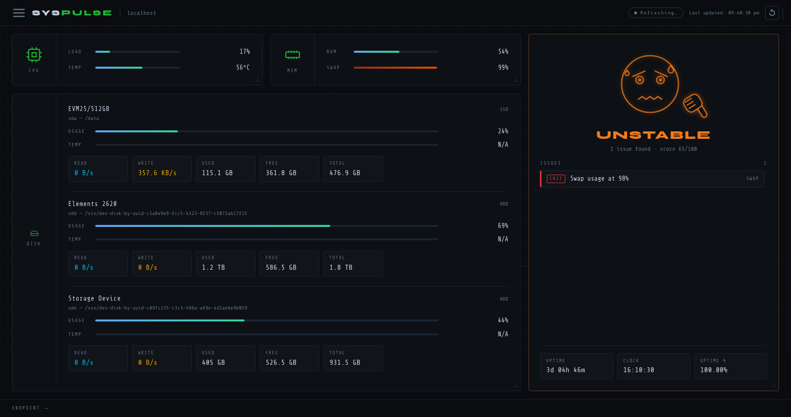
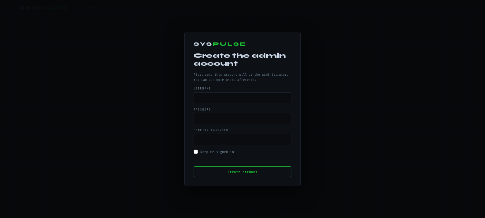
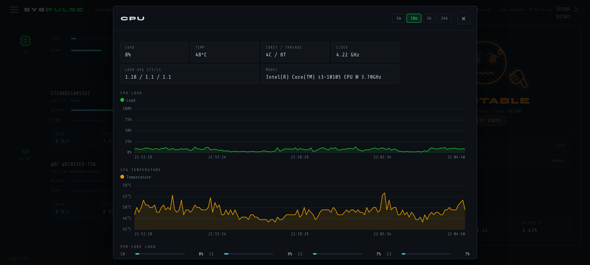
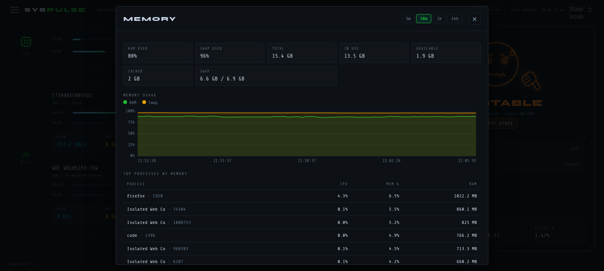
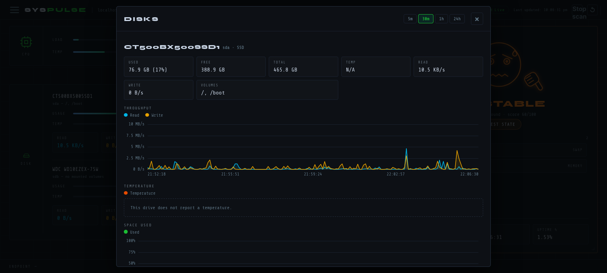
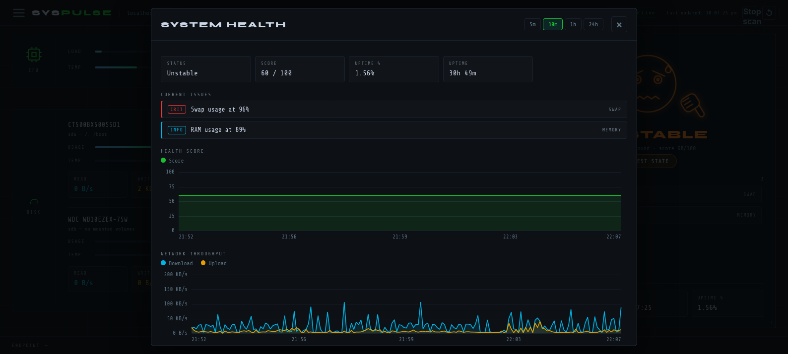
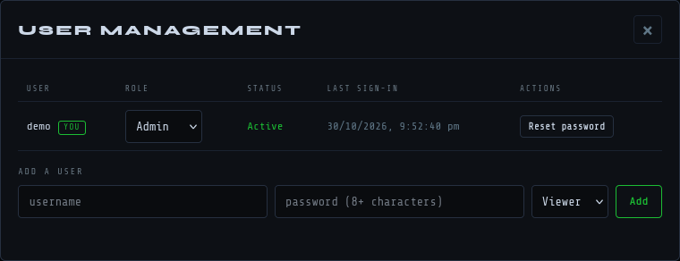
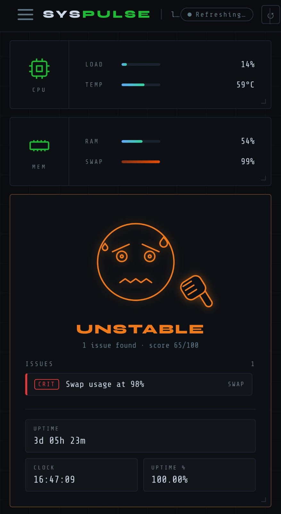
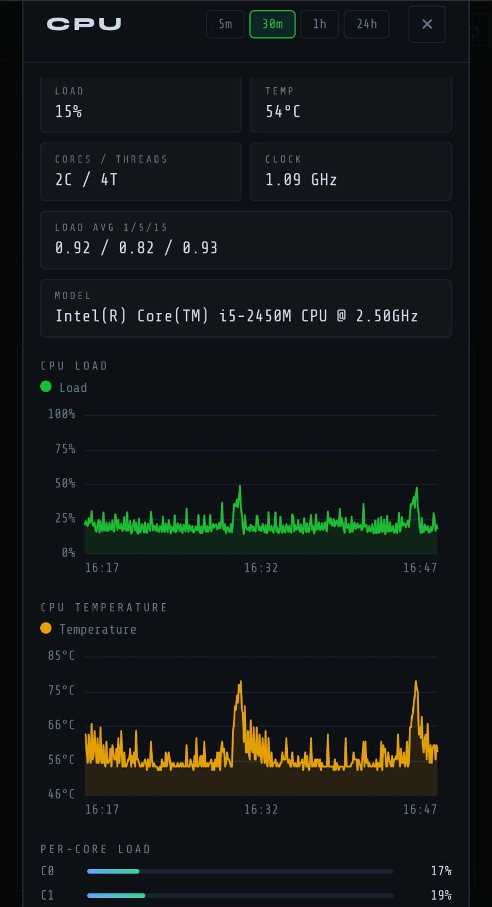
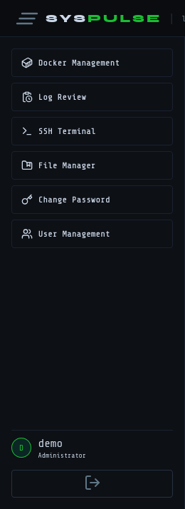

<div align="center">

# SysPulse

### A server dashboard built for teens

A self-hosted web panel for monitoring a server today, and managing it as the project grows.


**[Live demo: GithubPages](https://indian5000.github.io/Server-Dashboard/)** | **[Backend / API: Nest](https://syspulse.indian5000.hackclub.app)** | **[API documentation](https://syspulse.indian5000.hackclub.app/docs)**

</div>

---

## Table of Contents

1. [Demo and Credentials](#demo-and-credentials)
2. [Overview](#overview)
3. [Screenshots](#screenshots)
4. [Current Features](#current-features)
5. [Roadmap](#roadmap)
6. [Comparison with Existing Tools](#comparison-with-existing-tools)
7. [Installation](#installation)
8. [Hosting](#hosting)
9. [Backend and API](#backend-and-api)
10. [Configuration](#configuration)
11. [Security and Privacy](#security-and-privacy)
12. [Project Structure](#project-structure)
13. [Known Limitations](#known-limitations)
14. [AI Usage Declaration](#ai-usage-declaration)
15. [Contributing](#contributing)
16. [License](#license)
17. [Acknowledgements](#acknowledgements)

---

## Demo and Credentials

| Resource | Link |
|---|---|
| Live demo | **[https://indian5000.github.io/Server-Dashboard/](https://indian5000.github.io/Server-Dashboard/)** |
| Backend / API | **[https://syspulse.indian5000.hackclub.app](https://syspulse.indian5000.hackclub.app)** (interactive documentation at `/docs`) |
| Source code | [github.com/Indian5000/Server-Dashboard](https://github.com/Indian5000/Server-Dashboard) |

### Demo accounts

> **Administrator account**
>
> | Username | Password |
> |---|---|
> | **`demo`** | **`demo1234`** |
>
> **Read-only viewer account**
>
> | Username | Password |
> |---|---|
> | **`viewer`** | **`viewer1234`** |

> **Important:** these accounts are public and shared. Do not enter a real password anywhere on the demo, and expect
> demo data to be reset periodically. The demo is intended to run the same code as this repository and displays the
> real metrics of the machine that hosts it. Privileged features planned for later releases (terminal, power
> control, root file browser, Docker control) will be disabled on the public demo.

> **Note on Demo Availability:** Because this demo runs on a single-tenant local backend instance, connections or polling requests may occasionally timeout if multiple users are interacting with it at the exact same time. If the dashboard temporarily shows "No Signal" or appears offline, please wait a moment and refresh the page.
---

## Overview

SysPulse is a self-hosted server dashboard aimed at teenage developers and hobbyists: students who turn an old
laptop into a home server, people who host game servers, and beginners building a homelab who want to understand
their machine without first learning enterprise monitoring tools.

It is installed on the computer to be monitored and presents, in a web browser and in real time:

- CPU and memory usage;
- every physical drive (not only its partitions): capacity used, temperature, and read and write speed;
- an overall health card in which a wireframe emoji illustration changes expression as problems appear;
- detailed graphs for each card, opened by clicking the card.

The long-term goal is to grow from a monitor into a complete control panel that includes Docker management, game
server management, one-click service templates, a file browser, a terminal and power control, all behind user
sign-in and designed to work on phones. SysPulse runs entirely on the user's own hardware: it requires no cloud
account and sends no data to external services.

---

## Screenshots

*Place screenshots in `docs/images/` using the file names below and they will be displayed here.*

### Dashboard overview


CPU, memory and disk cards together with the overall health card, on desktop.

### First-run setup and sign-in


The first visit creates the administrator account. Afterwards the same screen is the sign-in form.

### Health card: the five states
| Healthy | Fair | Degraded | Unstable | Critical |
|---|---|---|---|---|
|  |  |  |  |  |

The illustration changes expression, and its thumb rotates from pointing up to pointing down, as the health score falls.

### Detailed overviews (opened by clicking a card)


CPU: load graph, temperature graph, per-core load, model and clock speed, and top processes(Not visible in screenshot).



Memory: RAM and swap graph, used, available and cached memory, and top processes by memory use.



Disks: throughput, temperature and space-used graphs for every drive.



Health: score history, current issues with severity, and network throughput.

### User management


Administrators add users, change roles, disable or delete accounts, and reset passwords.

### Mobile view
| Dashboard | Detail view |
|---|---|
|  |  |

### Navigation menu


---

## Current Features

### Live monitoring cards
- **CPU card.** Current load and, where the machine exposes a sensor, temperature.
- **Memory card.** RAM and swap usage.
- **Disk card, shown per physical drive rather than per partition.**
  - Usage bar and temperature bar.
  - Live read and write speed.
  - Used, free and total space for the whole drive, combining all of its volumes.
  - Partitions, LVM, RAID and Windows drive letters are mapped back to the physical drive they belong to.
- **Network throughput** is measured continuously and shown as a graph in the health detail view. A dedicated
  network card is on the roadmap.

### Overall health card
- A hand-drawn wireframe emoji illustration, inspired by the sunglasses and thumbs-up meme, with five stages:
  Healthy, Fair, Degraded, Unstable and Critical.
- A health score from 0 to 100 and a scrollable list of issues, each labelled INFO, WARN or CRIT. The checks cover
  CPU load and temperature, RAM, swap, drive fullness, drive temperature, Windows drive health status and battery.
- System uptime, the server's own clock, and an uptime percentage (the share of the last seven days during which
  the backend was running).
- Clear "Checking" and "No Signal" states while the backend is loading or unreachable.

### Detailed overview of each card
Clicking a card, or pressing Enter while it is focused, opens a detail view. Available for the CPU, memory, disk and
health cards, it provides:

- graphs over 5 minutes, 30 minutes, 1 hour or 24 hours;
- a hover crosshair that shows exact values on every graph;
- per-core CPU load, CPU model, core and thread count, clock speed and load average;
- top processes by CPU and by memory use;
- per-drive throughput, temperature and space graphs;
- health-score history and network throughput.

History is recorded by a background thread, at five-second resolution for one hour and one-minute averages for
24 hours, whether or not a browser has the page open.

### User management and sign-in
- First-run setup creates the administrator account.
- Sign in and sign out, with an optional "keep me signed in" setting.
- Two roles: administrator (full access) and viewer (read-only dashboard).
- Administrators can add, disable, enable and delete users, change roles, and reset passwords.
- Every user can change their own password.
- Server-enforced safeguards: passwords are hashed with scrypt, session tokens are stored only as hashes, five
  incorrect passwords cause a 60-second lockout, the last active administrator cannot be removed, and disabling a
  user or resetting their password ends all of their sessions.

### Mobile and tablet layout
The layout adapts to desktop, tablet and phone widths, including the detail dialogs and graphs.

### Cross-platform backend
A single Python backend serves Linux and Windows. Drive-to-volume mapping and temperature readings use sysfs on
Linux and the Storage module built into PowerShell on Windows, so no additional packages are required.

### Documentation
This README and automatically generated interactive API documentation, served at `/docs` on the backend.

---

## Roadmap

**Status key:** Implemented, Partial, Planned.

All planned features that run commands or access files on the host (terminal, power control, file browser, Docker
control, scripts) will be restricted to administrators, will request confirmation where appropriate, and will be
disabled on the public demo.

### Monitoring and visualisation
| Feature | Status | Notes |
|---|---|---|
| Detailed overview of each card | Implemented | Available for CPU, memory, disks and health. Every new card will receive one. |
| Network card | Planned | Dedicated card for upload and download speed and interfaces. Throughput is already measured. |
| Server visualizer in the style of a Cisco switch network diagram | Planned | A diagram of the server and its connections, drawn like a managed-switch port panel with live link activity. |
| Hover information box | Partial | Graphs already display values on hover. Information boxes for every card, icon and setting are planned. |

### Server control and management
| Feature | Status | Notes |
|---|---|---|
| Docker management | Planned | List, start, stop, restart and remove containers; view logs and resource use. |
| Port scanner | Planned | Show which ports are open on the server and which service is listening. |
| Power control | Planned | Shut down, restart and, where supported, suspend, with confirmation. |
| SSH terminal access | Planned | A terminal session in the browser. |
| File browser with root access | Planned | Browse and manage files, including privileged locations. Administrators only. |
| Manual fan control in the CPU detail card | Planned | Only where the hardware and operating system expose fan control. |
| Node server management | Planned | Manage multiple servers (nodes) from one panel, where available. |
| Auto power on | Planned | Remote power-on (for example Wake-on-LAN), where the hardware supports it. |

### Applications, services and games
| Feature | Status | Notes |
|---|---|---|
| Service template deployer | Planned | One-click stacks, such as a media template containing qBittorrent, Jellyfin, Radarr, Sonarr, Lidarr and related services. |
| Separate dashboard for self-hosted services | Planned | A launcher page that contains only links to the user's self-hosted services. |
| Game management panel | Planned | Start, stop, configure and monitor game servers. |

### Automation and maintenance
| Feature | Status | Notes |
|---|---|---|
| Auto task scripts | Planned | Schedule and run scripts and tasks from the panel. |
| Auto battery care | Planned | For laptops used as servers: protect battery health, for example by limiting the charge level. |
| Auto power-consumption throttling | Planned | Reduce power use automatically (for example when idle or too hot), where the operating system allows it. |
| Auto drive care | Planned | Automatic drive health checks, warnings and routine drive maintenance. |
| Auto install script | Planned | A single command that installs and configures SysPulse. |
| Auto panel sync and update | Planned | Keep the panel, and multiple panels, up to date automatically. |

### Interface
| Feature | Status | Notes |
|---|---|---|
| Light and dark modes | Planned | The interface is currently dark only. |
| Premade themes | Planned | Selectable colour themes. |
| Liquid-glass style interface | Planned | Translucent, frosted-glass panels. |
| Custom loading widgets and other custom animations | Partial | A loading state and card entrance animation exist. Custom loaders and further animations are planned. |
| Toast notifications throughout the interface | Planned | Pop-up messages for every action and alert. The page already contains the container for them. |
| Changeable language | Planned | Selectable interface language. |
| Mobile view | Implemented | Complete, and refined continuously. |

### Users, settings and help
| Feature | Status | Notes |
|---|---|---|
| User management | Implemented | See Current Features. |
| Settings panel and settings menu | Planned | A single place for themes, language, thresholds, refresh rate and feature switches. |
| Documentation | Partial | README and API documentation exist. A complete in-app guide is planned. |
| Local copy of the documentation, with a link to the online version | Planned | Documentation bundled with the application so it is available offline. |
| AI help box (local AI, disabled by default) | Planned | An optional assistant that uses a model running on the user's own machine. It remains off until the user enables it. |

*The navigation menu already contains buttons for Docker Management, Log Review, SSH Terminal and File Manager.
They are placeholders for roadmap features and are not yet functional.*

---

## Comparison with Existing Tools

**Current status:** at present SysPulse is a monitoring dashboard with user accounts, and it offers nothing that
established tools do not already provide. The comparison below describes the general strengths of well-known
products and the position SysPulse aims to occupy once the roadmap is delivered. Other products change over time;
consult their own documentation for current details.

| Tool | Primary strength | Intended difference in SysPulse |
|---|---|---|
| Netdata, Glances | Deep real-time system metrics and alerting | A gentler introduction for beginners, with the ability to act (Docker, services, games, power) as well as observe. |
| Grafana with Prometheus | Powerful, flexible dashboards for any data | No separate database, collector or query language to configure; one application. |
| Portainer | Docker management | Docker is one module within a wider panel covering hardware health, files, games and power. |
| Cockpit, Webmin | Full administration of a Linux server | A simpler interface suited to beginners, a phone-ready layout, and one codebase for Windows and Linux. |
| CasaOS, Umbrel | App-store style home servers | Adds hardware monitoring and maintenance (drives, battery, power) and does not require a dedicated operating system. |
| Homepage, Homarr, Dashy | Launcher pages for self-hosted services | The launcher is one page within a panel that also monitors and manages the machine. |
| Datadog and similar SaaS monitors | Large-scale cloud monitoring | Free, self-hosted, with no account required and no data leaving the machine. |

The combination SysPulse aims to provide:

1. **Designed for teenagers.** Approachable wording, an expressive health indicator instead of a wall of numbers,
   and a mobile-first layout.
2. **All-in-one.** Monitoring, management, deployment, a service launcher and game-server control in one
   lightweight Python application.
3. **Suited to the hardware teenagers actually own.** Old laptops and gaming PCs running Windows or Linux, with
   automatic battery care, drive care and power throttling.
4. **Local-first and private.** Self-hosted, no telemetry, and an optional local AI helper that is disabled by default.
5. **Free and open source** under the MIT License.

---

## Installation

### Requirements
- Python 3.10 or newer
- A current web browser
- Linux or Windows

### 1. Obtain the code
```bash
git clone https://github.com/Indian5000/Server-Dashboard.git
cd Server-Dashboard
```

### 2. Create a virtual environment and install dependencies

**Linux and macOS**
```bash
python3 -m venv .venv
source .venv/bin/activate
python -m pip install -r backend/requirements.txt
```

**Windows (PowerShell)**
```powershell
py -m venv .venv
.venv\Scripts\Activate.ps1
python -m pip install -r backend\requirements.txt
```
If PowerShell blocks the activation script, run `Set-ExecutionPolicy -Scope CurrentUser RemoteSigned` once.

### 3. Start the backend
Run the backend from inside the `backend` folder, because it imports `auth.py` from that location:
```bash
cd backend
fastapi dev main.py
```
The API is then available at <http://127.0.0.1:8000>, with documentation at <http://127.0.0.1:8000/docs>.

### 4. Open the frontend
In a second terminal, from the project folder:
```bash
python -m http.server 5500 --directory frontend
```
Then open <http://localhost:5500>. Opening `frontend/index.html` directly, or using the VS Code Live Server
extension, also works.

### 5. First run
The first page that loads asks you to create the administrator account. Do this immediately: until an
administrator exists, anyone who can reach the server is able to create it. Afterwards, add further users through
the menu under User Management.

### Platform notes
| Topic | Linux | Windows |
|---|---|---|
| Support status | Tested | Implemented but not yet tested on real Windows hardware; reports are welcome |
| CPU temperature | Available when the kernel exposes a sensor | Not available (Windows has no standard interface) |
| Drive temperature | NVMe drives work without setup. For SATA drives run `sudo modprobe drivetemp`, and add `drivetemp` to `/etc/modules-load.d/drivetemp.conf` to keep it after a reboot. | Run the terminal as Administrator. Some SATA drives and USB enclosures report nothing. |
| Drive information | Read from `/sys` | Read through PowerShell (`Get-Disk`, `Get-PhysicalDisk`) |

Where a sensor is not available, SysPulse displays "N/A" or a short explanatory note instead of failing.

### Troubleshooting
| Problem | Resolution |
|---|---|
| `ModuleNotFoundError: No module named 'auth'` | Start the backend from inside the `backend` folder. |
| The page reports that the backend is unreachable | Confirm the backend is running and that `API_BASE` (default `http://localhost:8000`) points to it. |
| Temperatures show "N/A" | See the platform notes above. |
| The health card remains on "Checking" | Open the browser console (F12) and look for a red error message. |

---

## Hosting

SysPulse has two parts: the backend (Python) and the frontend (static files). They can be hosted together or on
separate services.

> **Important:** serve any public copy over HTTPS. Sign-in tokens accompany every request, and browsers block an
> HTTPS page from calling a plain-HTTP backend. Create the administrator account before publishing the address.

### Option A: a single Linux server (backend and frontend together)

*Example configuration; adjust paths and the domain name.*

`/etc/systemd/system/syspulse.service`
```ini
[Unit]
Description=SysPulse backend
After=network.target

[Service]
User=YOUR_USER
WorkingDirectory=/opt/syspulse/backend
ExecStart=/opt/syspulse/.venv/bin/uvicorn main:app --host 127.0.0.1 --port 8000
Environment=SYSPULSE_DB=/opt/syspulse/data/users.db
Restart=on-failure

[Install]
WantedBy=multi-user.target
```
```bash
mkdir -p /opt/syspulse/data            # the folder named in SYSPULSE_DB
sudo systemctl daemon-reload && sudo systemctl enable --now syspulse
```
`YOUR_USER` must be able to write to `/opt/syspulse/data` and to `/opt/syspulse/backend`, where `heartbeats.log` is created.

`Caddyfile` (Caddy obtains and renews the HTTPS certificate automatically)
```
dash.example.com {
    encode gzip
    @api path /auth/* /server/* /users /users/* /docs /openapi.json
    handle @api {
        reverse_proxy 127.0.0.1:8000
    }
    handle {
        root * /opt/syspulse/frontend
        file_server
    }
}
```
Because the frontend and backend share one address, add the following line to `frontend/index.html`, before the
`auth.js` script tag:
```html
<script>window.API_BASE = location.origin;</script>
```

### Option B: frontend and backend on separate services
1. Deploy the backend to any host that can run a long-lived Python process, using these settings:
   - Root directory: `backend`
   - Install command: `pip install -r requirements.txt`
   - Start command: `uvicorn main:app --host 0.0.0.0 --port $PORT`
2. Deploy the `frontend` folder to any static host (for example GitHub Pages, Netlify or Cloudflare Pages).
3. Tell the frontend where the backend is, again before the `auth.js` script tag in `frontend/index.html`:
   ```html
   <script>window.API_BASE = "https://YOUR-BACKEND-URL";</script>
   ```

### Before hosting
- **Persistent storage.** Accounts are stored in a SQLite file (`users.db`, location set with `SYSPULSE_DB`) and
  uptime history in `heartbeats.log` next to `main.py`. Hosts that erase files on restart will lose both, so choose
  a host with a persistent disk or volume.
- **Metrics describe the host.** A hosted demo displays the real figures of the machine or container it runs on.
- **Create the demo accounts.** The [demo accounts](#demo-and-credentials) are set up by creating the administrator
  on first run and then adding the read-only `viewer` user under User Management.
- **Do not commit `backend/users.db`** to version control; it contains password hashes.

---

## Backend and API

**Backend:** [https://syspulse.indian5000.hackclub.app](https://syspulse.indian5000.hackclub.app)
**Interactive documentation:** `https://syspulse.indian5000.hackclub.app/docs`

To try the protected endpoints in the interactive documentation:

1. Open `POST /auth/login`, choose "Try it out", and send `{"username": "demo", "password": "demo1234"}`.
2. Copy the `token` value from the response.
3. On any other endpoint, enter `Bearer <your token>` in the `authorization` field and choose "Execute".

| Method | Endpoint | Access | Purpose |
|---|---|---|---|
| GET | `/auth/status` | Public | Reports whether first-run setup is still required |
| POST | `/auth/setup` | Public, first run only | Creates the first administrator |
| POST | `/auth/login` | Public | Signs in and returns a session token |
| POST | `/auth/logout` | Signed in | Ends the current session |
| GET | `/auth/me` | Signed in | Returns the current user |
| POST | `/auth/change-password` | Signed in | Changes the user's own password |
| GET | `/users` | Administrator | Lists users |
| POST | `/users` | Administrator | Creates a user |
| PATCH | `/users/{id}` | Administrator | Changes role, disables or enables, or resets the password |
| DELETE | `/users/{id}` | Administrator | Deletes a user |
| GET | `/server/system` | Signed in | Live metrics and health (polled by the dashboard) |
| GET | `/server/history?range=5m\|30m\|1h\|24h` | Signed in | Data for the graphs |
| GET | `/server/detail` | Signed in | CPU model, per-core load, memory details and top processes |

---

## Configuration

| Setting | Location | Default |
|---|---|---|
| `SYSPULSE_DB` | Environment variable | `backend/users.db` |
| `window.API_BASE` | A line in `frontend/index.html` | `http://localhost:8000` |
| Refresh interval | `REFRESH_INTERVAL_MS` in `frontend/script.js` | Defined in the file |
| Health thresholds and weights | `evaluate_health()` in `backend/main.py` | See the code |
| History resolution and retention | `_SAMPLE_EVERY`, `_FINE`, `_COARSE` in `backend/main.py` | 5 seconds for 1 hour; 1 minute for 24 hours |
| Uptime-percentage window | `_HB_WINDOW` in `backend/main.py` | 7 days |
| Sign-in rules (lengths, lockout, session lifetime) | Constants at the top of `backend/auth.py` | See the code |

---

## Security and Privacy

- Passwords are stored as salted scrypt hashes. Session tokens are stored only as SHA-256 hashes.
- Role checks are performed by the server, not only by the interface.
- Repeated incorrect passwords trigger a temporary lockout. Unknown usernames and incorrect passwords produce
  identical responses.
- All database queries are parameterised.
- Names obtained from the system (drives, processes) are inserted into the page as text, never as HTML.
- SysPulse sets no cookies and includes no telemetry or third-party analytics. The page loads two fonts from Google
  Fonts; remove the corresponding `<link>` tags in `index.html` for a fully offline panel.
- Process names, but never command lines, are visible to every signed-in user.

The sign-in token is sent in a request header, so use HTTPS whenever the panel can be reached by other people.
Cross-origin requests are currently allowed from any origin, which is acceptable for header-based tokens; restrict
this to your own address when deploying. Report security issues privately to **ahitagnibhattacharya072@gmail.com**.

---

## Project Structure

```
Server-Dashboard/
|-- backend/
|   |-- main.py            # metrics, drive detection, health scoring, history, API endpoints
|   |-- auth.py            # users, sessions and roles (SQLite and scrypt)
|   `-- requirements.txt
|-- frontend/
|   |-- index.html         # page, cards and dialogs
|   |-- style.css          # all styling, including the responsive layout
|   |-- script.js          # live polling and the cards
|   |-- auth.js            # sign-in screen and session handling
|   |-- users.js           # user-management and change-password dialogs
|   |-- charts.js          # small dependency-free canvas charts
|   `-- detail.js          # click-through detail views
|-- docker/
|   |-- Dockerfile         #Docker Config file
|   `-- docker-compose.yml #Docker Compose
|-- docs/
|   `-- images/            # screenshots used in this README
|-- README.md
`-- LICENSE.md
```

**Technology:** Python, FastAPI, Uvicorn, psutil, SQLite, and plain HTML, CSS and JavaScript (no framework and no build step).

---

## Known Limitations

- Windows support has not yet been verified on real Windows hardware.
- Graph history is kept in memory and starts empty after the backend restarts.
- Sessions have a fixed lifetime (12 hours, or 30 days with "keep me signed in"). There is no password-reset
  e-mail; an administrator resets passwords. If every administrator account is lost, stop the backend, delete
  `users.db`, and run first-run setup again.
- Most roadmap items are not yet implemented, and the corresponding menu buttons are placeholders.
- The sign-in token is held in the browser's storage, so the site should be protected against script injection.
  SysPulse never inserts untrusted text into the page as HTML.

---

## AI Usage Declaration

SysPulse was built primarily by the author, with core frontend modules (`users.js`, `charts.js`, and `detail.js`) generated entirely by AI, and other parts incorporating AI-assisted snippets explicitly marked with inline comments. This section records where AI was used.

**Tool used:** Claude (Anthropic), through a chat interface.

**Work performed by the AI.** The AI generated:
- the complete source code for `users.js`, `charts.js`, and `detail.js`;
- specific authentication and utility helper blocks;
- portions of the drive detection and temperature reading logic.

**Work performed by the author.** The author designed the product and its feature list; wrote the core dashboard layout, cards, navigation, polling scripts, and the primary backend structure; integrated the AI-generated modules and snippets; and is responsible for testing and maintaining the project.

**How AI use is marked.**
- Fully AI-generated files include descriptive file header comments.
- Other AI-assisted code blocks carry explicit inline comments (such as `Ai Generated`).
- The table below outlines the origin of each part of the project.

| Part | Origin |
|---|---|
| `frontend/index.html`, `style.css`, `script.js` (layout, cards, menu, polling) | Written by the author (a few helper snippets AI-copied and marked) |
| Disk card, health card, responsive layout, dialogs and styles | Written by the author, with minor AI-assisted styling blocks marked |
| `frontend/auth.js` | Written by the author, with AI-copied functions marked with inline comments |
| `frontend/users.js`, `charts.js`, `detail.js` | AI-generated |
| `backend/main.py` (metrics, drive detection, health scoring, uptime, history, endpoints) | Written by the author, with drive/temperature detection snippets copied from AI and marked |
| `backend/auth.py` | Written by the author, with token/auth helper blocks copy-pasted from AI |
| `README.md`, `LICENSE.md` | Drafted by the author |
---

## Contributing

Suggestions, bug reports and pull requests are welcome, in particular:

- testing on Windows and on unusual hardware (additional sensors, RAID, USB drives);
- translations, once the language setting exists;
- work on any item in the [Roadmap](#roadmap).

Please open an issue to discuss larger changes before starting. If a contribution contains AI-generated code,
state this in the pull request.

---

## License

SysPulse is released under the MIT License. See [LICENSE.md](LICENSE.md).

---

## Acknowledgements

- Built as a submission to Hack Club Stardance.
- [FastAPI](https://fastapi.tiangolo.com/), [psutil](https://github.com/giampaolo/psutil), [Uvicorn](https://www.uvicorn.org/) and [SQLite](https://sqlite.org/).
- Icons from [Lucide](https://lucide.dev/) and [Bootstrap Icons](https://icons.getbootstrap.com/); the Syne and Share Tech Mono fonts from Google Fonts.
- The many self-hosting dashboards and homelab tools that inspired this project.

<div align="center">

**Created by Ahitagni Bhattacharya | [github.com/Indian5000](https://github.com/Indian5000)**

</div>